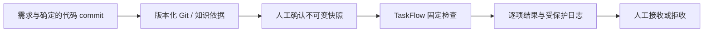
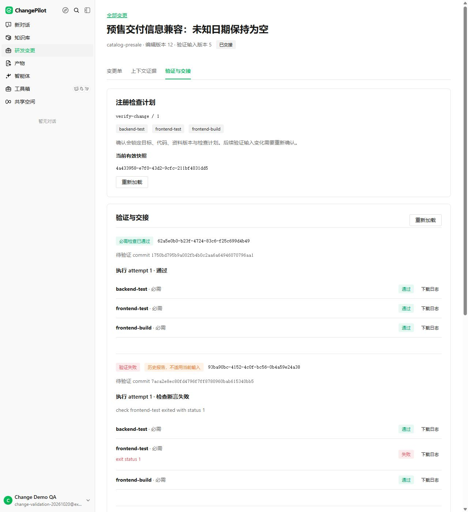
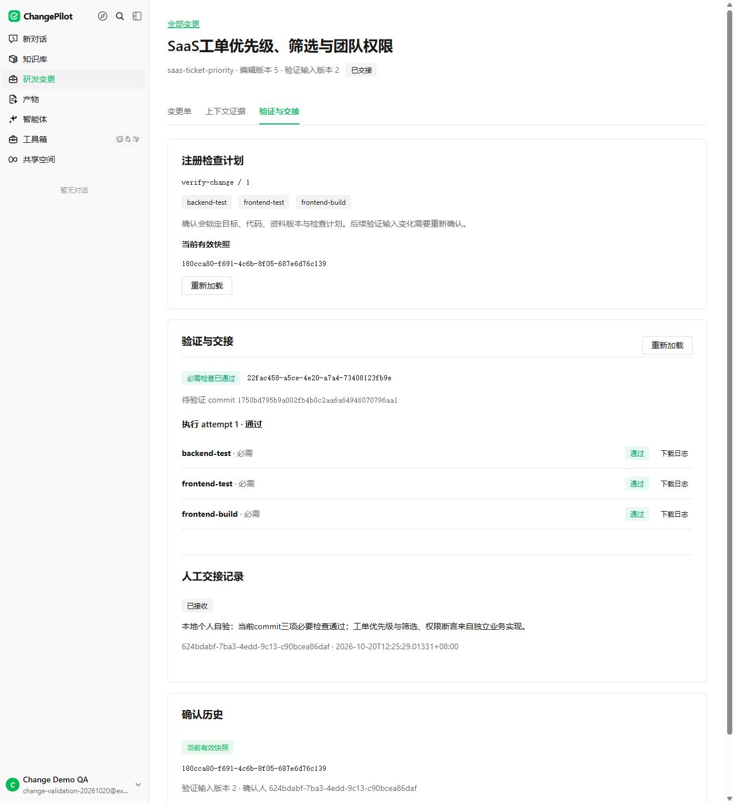

# ChangePilot

**研发变更与验证工作台：把需求、版本化依据、真实检查和人工交接连成一条可追溯的流程。**

Built on Tencent/WeKnora. Versioned evidence, trusted verification, and human handoff for development changes.

[源码启动](./docs/CHANGE_PILOT_QUICKSTART.md) · [功能与接口](./CHANGE_WORKSPACE.md) · [验证记录](./docs/CHANGE_WORKSPACE_VALIDATION_20261020.md) · [上游与贡献](#上游与贡献)

开发者使用 Codex 或 Claude Code 修改业务代码后，通常还要回答：改动依据来自哪个版本？哪些检查实际执行过？失败修复后旧报告是否仍可用？谁最终接收了这次变更？ChangePilot 将这些信息组织为一张变更单，执行工作交给独立的 TaskFlow-Go。



## 看一次完整的变更

商品预售样例从受控故障开始，经历检查失败、人工拒收、修复提交、重新检查和人工接收。历史失败与拒收记录仍可追溯。



另一个 SaaS 工单样例复用同一核心，验证优先级保存、筛选计数、分页和团队权限。



## 三个仓库各自负责什么

| 仓库 | 职责 |
| --- | --- |
| **[ChangePilot](https://github.com/yfj898/change-pilot)** | Go/Vue 变更单、版本化依据、模型影响建议、确认快照、报告展示与人工交接 |
| **[TaskFlow-Go vNext](https://github.com/yfj898/taskflow-go-next)** | 可信 Git commit、操作者注册的固定 argv 检查、事务幂等、generation fencing、报告与日志 |
| **[Go/Vue 业务样例](https://github.com/yfj898/change-workspace-demo)** | 商品预售与 SaaS 工单两个可运行的业务包、真实业务代码、领域断言及故障/修复提交 |

ChangePilot 不执行用户上传的命令。操作者在服务端注册工作空间、仓库、业务包和检查映射；业务清单只描述资料、模块与验收项。适配另一个业务时，更换领域资料、业务代码和断言，无需在工作台核心增加行业分支。

## 关键实现

- **依据可追溯**：引用绑定仓库、完整 commit、路径与可选行范围；服务端从 Git 对象重读正文，知识文档用于发现与权限映射。
- **建议与确认分开**：复用模型生成可编辑影响建议。开发者独立确认输入快照；模型截断或调用失败返回真实错误，保留原草稿。
- **编辑与验证版本分开**：`revision` 用于 CAS，`input_revision` 仅在验证输入变化时递增。标题或备注编辑不使报告失效；改代码或依据会使旧快照不再适用于当前交接。
- **结果不明可恢复**：先保存 run UUID 与快照配对，再提交执行；响应丢失后核对同一 UUID。新的当前快照可以独立运行，历史未决提交仍可追踪。
- **交接受实际结果约束**：当前快照的全部必要检查通过，才可人工接收。失败、缺项、过期输入和旧 generation 不能冒充通过。
- **机器入口只读**：新增 `weknora changes context` / `changes runs get`；工作空间 HTTP MCP 提供 `get_change_context`、`get_verification_run`。API Key 需 `read_changes`；报告和日志重验关联快照的知识范围。

主要代码位于 [`internal/application/service/change.go`](./internal/application/service/change.go)、[`internal/application/repository/change.go`](./internal/application/repository/change.go)、[`frontend/src/views/changes`](./frontend/src/views/changes) 与 [`internal/mcpserver`](./internal/mcpserver)。完整状态、授权与接口约定见 [CHANGE_WORKSPACE.md](./CHANGE_WORKSPACE.md)。

## 已验证到哪一层

2026-10-20，在隔离的本地 Linux/WSL + PostgreSQL/Redis + TaskFlow 环境中完成以下检查。业务使用自有样例与受控故障提交。

| 层次 | 实际结果 |
| --- | --- |
| 完整服务 | `./cmd/server` Linux/CGo 构建通过；PostgreSQL 上游版本 124 → 127 增量迁移及保留夹具检查通过 |
| 前端 | Vue TypeScript、15 项 i18n 审核、Vite 构建通过；浏览器完成编辑、确认、失败拒收、修复重跑、接收、刷新和日志下载 |
| 商品闭环 | 故障提交使前端 11 项断言中 2 项失败；修复提交的 3/3 必要检查通过后人工接收 |
| 工单闭环 | 同一工作台与检查模板完成第二业务验证和人工交接，业务应用实际保存优先级并验证筛选/分页 |
| 模型与检索 | `qwen3.5:4b` 真实生成建议；3 份中文文档入库，2 条向量查询首位命中对应规则。两条样例的命中不作为准确率基准 |
| 工具协议 | 实际 HTTP、CLI、HTTP MCP 协议客户端读取同一工单 context/run 一致；MCP 显式选择两个只读工具 |
| 执行可靠性 | TaskFlow 真实 MySQL 同 UUID 并发幂等、进程中断后新 generation 接管、真实成功/失败子进程与日志下载通过 |
| 权限与兼容 | 跨空间与越知识范围读取拒绝；关闭新增功能后，旧知识库和文档读取仍可用 |

模块回归与真实服务调用分别记录在 [验证记录](./docs/CHANGE_WORKSPACE_VALIDATION_20261020.md)。运行数据库、凭据、模型文件与本机运行配置不作为仓库交付物。

## 从源码运行

推荐 **Linux 或 WSL Ubuntu**，使用 Go 1.26、Node.js 24、CGo/SQLite 开发库、PostgreSQL/ParadeDB、Redis。完整说明在 [源码启动手册](./docs/CHANGE_PILOT_QUICKSTART.md)。

```bash
git clone https://github.com/yfj898/change-pilot.git
git clone https://github.com/yfj898/taskflow-go-next.git
git clone https://github.com/yfj898/change-workspace-demo.git
cd change-pilot
```

先按 [TaskFlow verification quickstart](https://github.com/yfj898/taskflow-go-next/blob/main/docs/VERIFICATION_QUICKSTART.md) 配置可信仓库和固定检查，再按本仓库手册启动后端、前端并填写实际 tenant 映射。

上游 `docker-compose.yml` 默认使用 `wechatopenai/weknora-*` 镜像；直接 `docker compose pull && up` 得到的是上游发布版本。运行本二开须构建本仓库源码，配置新增段与业务 Git 目录。模型只在生成建议和知识入库/检索时需要；已保存记录、确认和检查交接使用各自服务。

## 上游与贡献

本项目基于 **[Tencent/WeKnora](https://github.com/Tencent/WeKnora)**，固定基线 [`737d237283ee1a8abd19a4755ad3197f79ce1303`](https://github.com/Tencent/WeKnora/commit/737d237283ee1a8abd19a4755ad3197f79ce1303)，保留上游 Git 历史。

- **上游能力**：身份与多工作空间、RBAC、知识解析与检索、模型适配、现有 API/CLI/MCP 传输及前端设计系统。
- **本项目新增**：Change 领域类型、版本化迁移、repository/service/handler、Vue 三页流程、TaskFlow 对接、CLI 读取命令、两个只读 MCP 工具，以及撤权恢复、提交幂等、快照适用性和人工交接回归。
- **独立业务与执行端**：TaskFlow-Go 与 Go/Vue 业务样例分别维护。同步的 TaskFlow 客户端来源见 [`internal/integration/taskflowclient/README.md`](./internal/integration/taskflowclient/README.md)。

产品展示名为 **ChangePilot**。`github.com/Tencent/WeKnora` Go module、`weknora` CLI、既有 API 路由、环境变量和存储键保留兼容；WeKnora Cloud 等供应商与上游工具名称仍指向原产品。

原英文首页完整保留于 [README.upstream.md](./README.upstream.md)，原中文首页见 [README_CN.md](./README_CN.md)。知识、模型和部署能力的详细说明见 [上游文档](https://weknora.weixin.qq.com/docs/)；本项目变更工作台以本仓库文档为准。

保留原 [LICENSE](./LICENSE)、[THIRD_PARTY_NOTICES.md](./THIRD_PARTY_NOTICES.md) 与许可证文件。各组件依其来源条款使用；自有 TaskFlow 客户端的许可说明单列于其来源文档。
